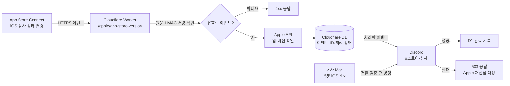

# 반다라트 iOS 심사 알림 구성

## 현재 상태

| 구성 | 상태 |
| --- | --- |
| iOS 심사 상태 15분 조회 | 회사 Mac에서 운영 중. 실제 웹훅 전달을 확인할 때까지 유지 |
| Cloudflare Workers Free | 계정에서 활성 확인. 결제 수단 없음 |
| Cloudflare Worker, D1 | 배포 결과를 확인한 뒤 이 문서에 기록 |
| Apple 웹훅 등록과 비밀값 | 운영자가 직접 설정할 단계. 아직 등록·검증되지 않음 |
| Discord 실제 전달 | 미검증. 별도 승인 없이 테스트 메시지를 보내지 않음 |



## 용어

- **Worker**: Apple이 보낸 HTTPS 요청을 받는 Cloudflare 실행 코드. 회사 Mac의 공개 포트를 열지 않는다.
- **D1**: Worker가 이벤트 ID와 처리 결과를 저장하는 Cloudflare 데이터베이스.
- **Binding**: Worker가 `EVENTS`라는 이름으로 D1에 접근하도록 잇는 설정.
- **Wrangler**: Worker와 D1을 Cloudflare에 배포하는 공식 CLI.
- **Apple 웹훅 공유 비밀값**: Apple과 Worker 양쪽에 동일하게 넣는 새 비밀값. 요청 원문 서명 검증에만 사용한다.

## 구축 순서

1. Cloudflare 계정의 **Workers Free**와 결제 수단 상태를 확인한다. 유료 전환이나 카드 등록은 하지 않는다.
2. 승인된 최소 권한(`account:read`, `user:read`, `workers:write`, `d1:write`)으로 회사 Mac의 Wrangler를 연결한다. OAuth 승인은 운영자가 직접 수행한다.
3. D1 데이터베이스를 만들고 `migrations/0001_webhook_events.sql`을 적용한다. 발급된 D1 ID를 `wrangler.jsonc`의 `EVENTS` Binding에 기록한다.
4. Worker를 배포하고 공개 HTTPS 주소의 `/apple/app-store-version` 경로가 존재하는지 확인한다. 비밀값이 없을 때는 요청을 처리하지 않는다.
5. 운영자가 Cloudflare에 `APPLE_WEBHOOK_SECRET`, `APP_STORE_CONNECT_KEY_ID`, `APP_STORE_CONNECT_ISSUER_ID`, `APP_STORE_CONNECT_PRIVATE_KEY`, `DISCORD_WEBHOOK_URL`을 직접 등록한다. 값은 저장소, 터미널 인수, 문서, 채팅에 넣지 않는다.
6. 운영자가 동일한 공유 비밀값으로 앱 `6743101965`의 `APP_STORE_VERSION_APP_VERSION_STATE_UPDATED` 웹훅을 Apple에 등록한다.
7. Apple ping 및 전달 기록으로 수신과 서명을 확인한다. Ping은 Discord에 보내지 않는다. 실제 상태 전환과 Discord 전달을 확인한 뒤에만 15분 조회 중단을 검토한다.

## 앱별 Worker 구성

같은 `src/ios-webhook-worker.ts`를 앱마다 별도 Worker로 배포한다. Worker 이름, D1, 비밀값, Discord 채널은 앱끼리 공유하지 않는다.

| 앱 | 설정 예시 | App Store 앱 ID | 키 종류 |
| --- | --- | --- | --- |
| 반다라트 | `wrangler.example.jsonc` | `6743101965` | 팀 키 |
| 여비 | `wrangler.yeobee.jsonc` (운영 설정) | `6475346701` | 개인 키 |

- `vars`: `APP_STORE_ID`(숫자만), `APP_NAME`, `APP_STORE_CONNECT_KEY_TYPE`(`team` 기본값 또는 `individual`). 값이 없거나 올바르지 않으면 Worker는 외부 요청 없이 503을 반환한다.
- 비밀값: `APPLE_WEBHOOK_SECRET`, `APP_STORE_CONNECT_KEY_ID`, `APP_STORE_CONNECT_PRIVATE_KEY`, `DISCORD_WEBHOOK_URL`. 팀 키일 때만 `APP_STORE_CONNECT_ISSUER_ID`가 필요하다.
- 배포: `wrangler deploy -c wrangler.yeobee.jsonc`처럼 앱별 설정 파일을 지정한다.

## 요청 검증과 중복 방지

Worker는 `x-apple-signature`의 HMAC-SHA256 값을 **요청 원문 바이트**로 계산한 값과 상수 시간 비교로 대조한다. 서명이 틀리거나 필수 설정이 없으면 Apple API나 Discord에 요청하지 않는다. 서명이 맞아도 `APP_STORE_VERSION_APP_VERSION_STATE_UPDATED` 이벤트만 처리하고, Apple API에서 버전 ID가 반다라트 앱 `6743101965`에 속하는지 다시 확인한다.

D1의 `webhook_events.id` 고유 키를 Apple 이벤트 ID로 사용한다. 같은 ID는 한 번만 처리하도록 시도하며, 동시 요청은 2분 처리 임대로 조정한다. Discord 성공 응답 뒤 D1 완료 기록이 실패하는 드문 경우에는 재전달로 중복 메시지가 생길 수 있다. 운영자는 Apple 전달 기록과 D1을 함께 확인해야 한다.

## Apple 웹훅 공유 비밀값 재발급

공유 비밀값은 Cloudflare 비밀값과 App Store Connect 웹훅 설정에만 저장하며, 두 곳 모두 저장 후에는 다시 볼 수 없다. 저장소·문서·채팅에 기록하지 않는다. 값을 잃어버리거나 노출이 의심되면 복구하지 말고 새로 만든다.

1. 새 값을 만들어 Worker에 넣고 같은 값을 클립보드에 복사한다. 값이 화면이나 셸 기록에 남지 않는다.
   ```bash
   S=$(openssl rand -hex 32); printf %s "$S" | pbcopy; printf %s "$S" | npx wrangler secret put APPLE_WEBHOOK_SECRET --name <worker-name>; unset S
   ```
2. App Store Connect → 사용자 및 액세스 → 통합 → 웹훅에서 해당 웹훅을 열고 암호 칸에 붙여넣은 뒤 저장한다.
3. 같은 화면의 **테스트**로 Ping을 보내고 최근 전달 내역이 **성공**인지 확인한다. 1과 2 사이에 도착한 이벤트는 401로 실패하므로 전달 내역에서 재전송한다.

## 실패, 테스트, 전환과 롤백

- Apple API, D1 또는 Discord가 실패하면 Worker는 503을 반환하고 완료로 기록하지 않는다. 전달 실패는 Apple 전달 기록에서 확인해 재전달한다.
- 승인된 검증 순서는 공개 경로 확인 → Apple ping 수신·서명 확인 → 실제 상태 전환·Discord 전달 확인이다. 테스트 Discord 메시지는 **정확한 내용과 한 건의 전송을 별도 승인받은 뒤** 보낸다.
- 실제 Apple 이벤트 수신, Worker 처리 성공, D1 완료 기록, `#스토어-심사` 메시지를 모두 대조한 뒤 회사 Mac의 `ios:watch` 중단을 결정한다.
- Worker 장애 시 Apple 웹훅 전달 기록을 보존하고 원인을 수정해 재전달한다. 검증 전에는 기존 15분 조회가 계속 알림을 담당한다. 필요하면 Apple 웹훅을 비활성화하고 조회 감시를 유지한다.
- Android Google Play 심사 알림과 iOS 고객 후기 알림은 이 구성과 별개다.

자세한 Apple API와 로컬 조회 운영법은 [iOS 심사 상태 운영 문서](IOS_STORE_OPERATIONS.md)를 참고한다.
